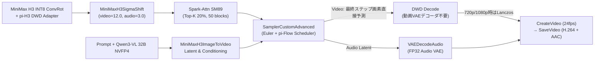
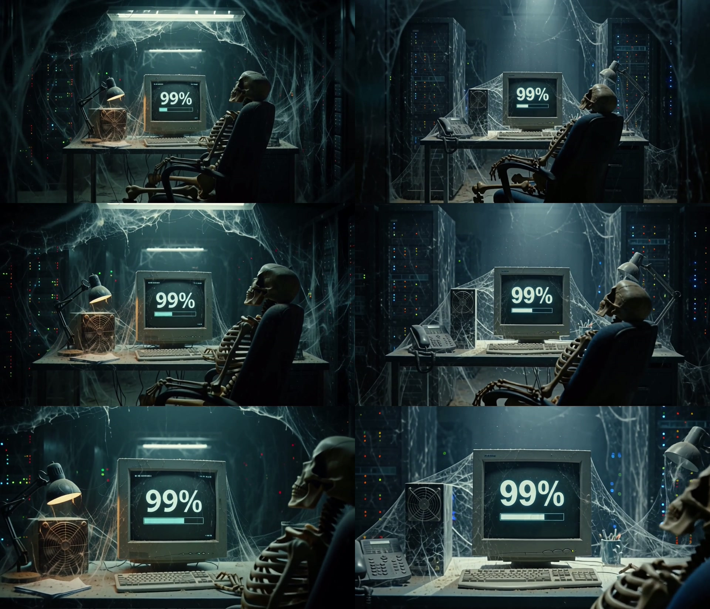
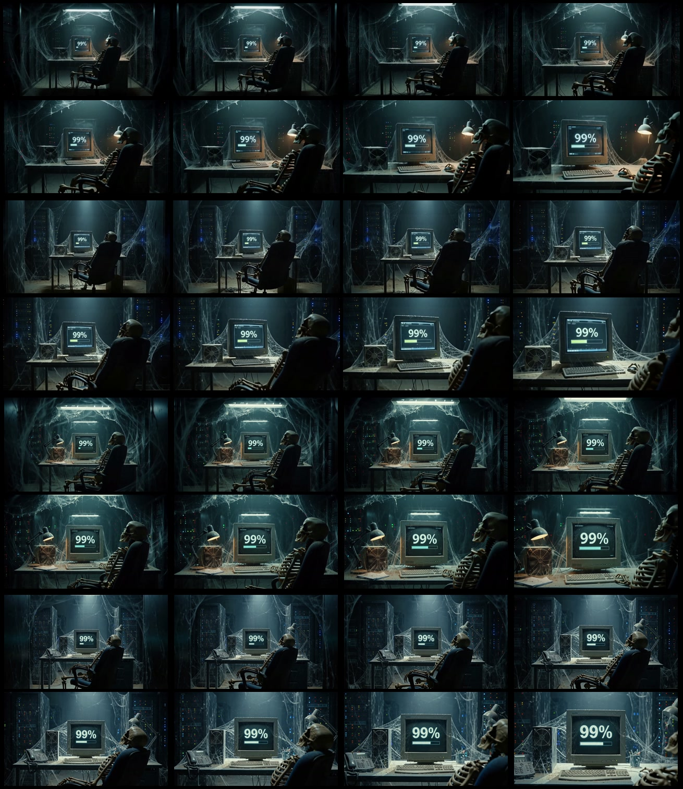
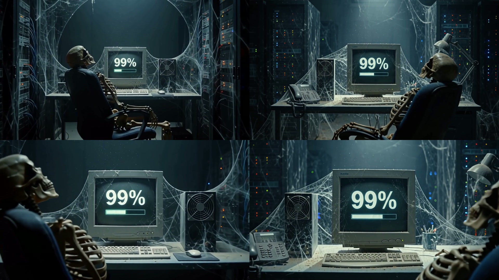
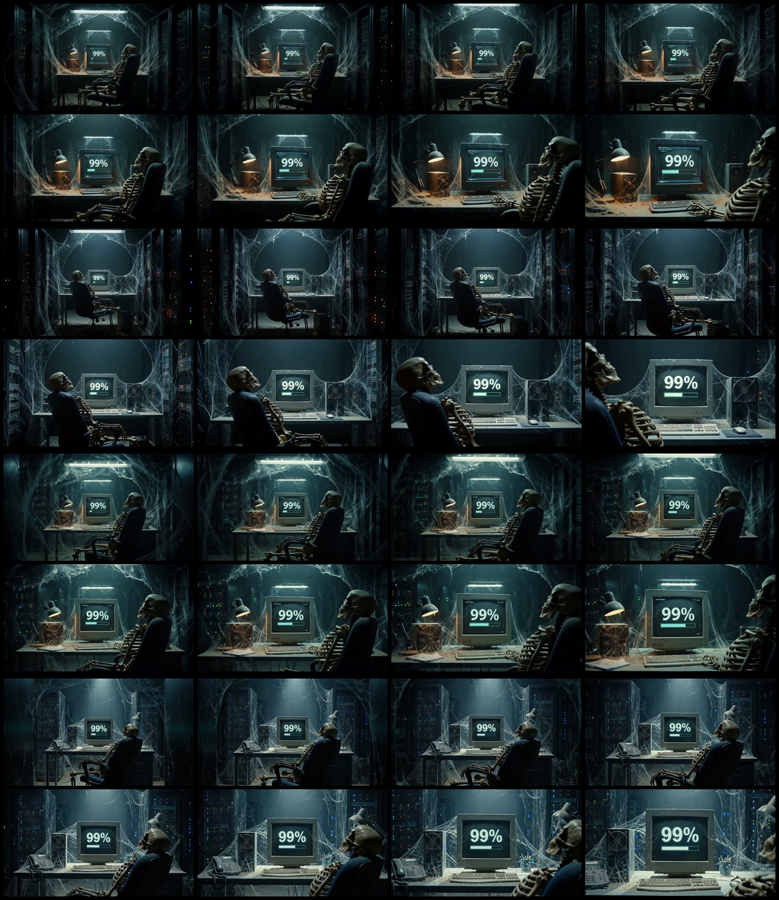

# pi-H3 1.0 (DWD + Spark-Attn SM89) on RTX 4090 詳細実験レポート

> **実験日**: 2026年11月23日  
> **対象モデル**: MiniMax H3 (`INT8 ConvRot`) + Lakonik `pi-H3 1.0` DWD Adapter (`2-step` / `4-step`)  
> **実行環境**: NVIDIA GeForce RTX 4090 (24,564 MiB VRAM, Ada Lovelace / SM 8.9) / Docker + WSL2 (`PyTorch 2.11.0+cu130`, `ComfyUI v0.46.0`)  
> **検証範囲**: 全17ラン（Suite 1: `480p` / `768p` × 8ラン、Suite 2: `720p` / `1080p` × 9ラン）

---

## 1. エグゼクティブサマリー

MiniMax H3 の動画・音声同時生成を 2〜4 ステップに高速化するアダプター **pi-H3 1.0 (DWD: Decoding Without a Decoder)** と、Ada Lovelace (SM89) 向けスパースアテンション **Spark-Attn SM89 (`ComfyUI-Spark-H3 v0.2.0`)** を組み合わせ、ローカルの **RTX 4090 (24GB)** 上で徹底検証しました。

### 主要な検証結果（ウォーム実行・5.17秒 / 124フレーム / 24fps / ステレオ音声付き）

| 構成 | 生成解像度 (DiT) | 出力解像度 (MP4) | ステップ | ComfyUI実行時間 | ステップ内訳 (推論 / 最終+DWD) | ピークVRAM | 平均/最大電力 |
| :--- | :---: | :---: | :---: | :---: | :---: | :---: | :---: |
| **480p 2-step** | `864×480` | `864×480` | 2 | **19.73 秒** | `3.92s` + `~19s` | 23,096 MiB | 133.4 / 303.2 W |
| **480p 4-step** | `864×480` | `864×480` | 4 | **28.37 秒** | `4.14 / 4.10 / 3.90s` + `11.95s` | 22,979 MiB | 167.3 / 295.4 W |
| **720p 2-step** | `1280×736` | `1280×720` | 2 | **32.88 秒** | `9.67s` + `~21s` | 24,029 MiB | 174.2 / 394.9 W |
| **720p 4-step** | `1280×736` | `1280×720` | 4 | **49.72 秒** | `9.77 / 8.21 / 8.58s` + `15.87s` | 23,969 MiB | 223.3 / 401.1 W |
| **768p 2-step** | `1344×768` | `1344×768` | 2 | **32.32 秒** | `10.45s` + `~22s` | 24,007 MiB | 197.7 / 403.7 W |
| **768p 4-step** | `1344×768` | `1344×768` | 4 | **49.39 秒** | `9.99 / 8.64 / 8.98s` + `16.14s` | 23,811 MiB | 245.6 / 407.6 W |
| **1080p Upscaled 2-step** | `1344×768` | `1920×1080` | 2 | **39.91 秒** | `10.14s` + `~22s` (+Lanczos/Enc) | 23,949 MiB | 159.2 / 404.3 W |
| **1080p Upscaled 4-step** | `1344×768` | `1920×1080` | 4 | **62.50 秒** | `11.41 / 9.26 / 9.27s` + `17.37s` (+Lanczos/Enc) | 23,405 MiB | 195.0 / 405.1 W |
| **1080p Native 2-step** | `1920×1088` | `1920×1080` | 2 | ❌ エラー (24.28秒) | `chunk_path="drop_k"` 未対応エラー | 23,389 MiB | 43.6 / 61.7 W |

### 特に重要な発見

1. **公式 RTX 3090 (`gpu-unlock`) ベンチマークを上回る実測値**:  
   公式ドキュメントの `1344×768` 2-step 5秒動画は RTX 3090 + Linux `gpu-unlock` で **34.6秒** ですが、本実験の RTX 4090 (Windows + Docker/WSL2、`gpu-unlock` なし) では **32.32秒**（Audio VAEデコードおよび H.264/AAC MP4 エンコード込み）を達成しました。
2. **2-step と 4-step の明確なトレードオフ**:  
   - **2-step (`32.32s @ 768p`)**: プロトタイピングや構図・音声の高速確認に最適。ただし細部（モニターの `"99%"` 文字や骸骨の骨格・サーバーラックの質感）にわずかなソフトさ・揺らぎが残ります。
   - **4-step (`49.39s @ 768p`, +17.07s)**: 全体の光量ダイナミックレンジ、シャープネス、立体感、音声の安定性（ステレオピークが `-0.83 dB` → `-1.83 dB` へ収まりクリッピング余裕が改善）がいずれも一段階向上します。
3. **720p と 768p は所要時間がほぼ同等（約0.5秒差）**:  
   MiniMax H3 の空間パッチ制約（32ピクセル倍数）により 720p は `1280×736` (34,625 トークン) で生成してから `1280×720` へクロップ／リサイズします。`1344×768` (37,881 トークン) とのトークン差は約 8.6% に過ぎないため、**768p (`32.32s / 49.39s`) を選ぶ方が画質・時間対効果ともに最も優秀**です。
4. **1080p の現実解とネイティブ 1080p の壁**:  
   - **実用解 (`1344×768` → Lanczos `1920×1080`)**: 2-step で **39.91秒**、4-step で **62.50秒**。DWD出力をそのまま高品質リサイズして 1080p H.264 MP4 化できます（768p からの追加コストは 2-step で +7.6秒、4-step で +13.1秒のCPUリサイズ・エンコード時間）。
   - **ネイティブ `1920×1088` の制約**: VRAM 24GB 内で動かすために `Spark-H3` の実験的チャンク分割 (`chunk_path="drop_k"`) を有効化しましたが、現行 `v0.2.0` 配布 wheel (`spark_h3_kitchen 0.2.37`) には分割カーネルの CUDA 拡張シンボルが含まれておらず `RuntimeError: Spark chunked requires a rebuilt comfy-kitchen CUDA extension` で停止しました。

---

## 2. システム構成・モデル・技術アーキテクチャ

### 2.1 ハードウェア & ソフトウェア環境

| 項目 | 仕様 / バージョン |
| :--- | :--- |
| **主計算GPU (`cuda:0`)** | NVIDIA GeForce RTX 4090 (24,564 MiB VRAM / SM 8.9 / `cudaMallocAsync`) |
| **補助GPU (`cuda:1`)** | NVIDIA GeForce RTX 3060 (12,288 MiB VRAM / 本実験では未使用) |
| **ホストRAM (WSL2割当)** | 116,045,914,112 bytes (~108.1 GiB) |
| **Dockerイメージ** | `local/minimax-h3-comfyui:v0.46.0-pih3` ([pih3-4090.Dockerfile](file:///D:/Prj/minimax-h3-compose/docker/pih3-4090.Dockerfile)) |
| **ベースイメージ** | `pytorch/pytorch:2.11.0-cuda13.0-cudnn9-runtime` |
| **Python / PyTorch / CUDA** | Python `3.12.3` / PyTorch `2.11.0+cu130` / CUDA `13.0` |
| **ComfyUI** | `v0.46.0` (Port `8195 -> 8188`, `--disable-pinned-memory --preview-method none`) |
| **主要カスタムノード** | `ComfyUI-piFlow` (`e0ca46f`, v1.4.2) / `ComfyUI-Spark-H3` (`v0.2.0` Linux SM89) / `ComfyUI-SolAttn_triton` (`26d816e`) |
| **高速化カーネル** | `spark_h3_kitchen 0.2.37+spark.h3.sm89.cu130.1` / `comfy-kitchen 0.2.41` / `sageattention 2.2.0+cu130torch2.11` |

### 2.2 使用モデル一覧（SHA-256 検証済み）

すべてのモデルは `D:\Prj\minimax-h3-compose\models` に配置し、Docker コンテナへマウントして共有しました。

| 種別 | ファイル名 | サイズ (Bytes) | SHA-256 |
| :--- | :--- | :---: | :--- |
| **DiT 基盤モデル** | `diffusion_models/minimax_h3_fl2va_pruned_int8_convrot.safetensors` | `20,970,379,616` (19.53 GiB) | `E889202C41DAFB67B10D67B97F0D8541508036A6090AF23425A5C2615D03C47A` |
| **テキストエンコーダ** | `text_encoders/qwen3vl_32b_minimax_h3_nvfp4_awq.safetensors` | `15,687,142,551` (14.61 GiB) | `35A88D51044231FE332301D7A62AA81E3F2CBA62FEBEB446E2C1E3E0EF76F2C6` |
| **動画 VAE (入力用)** | `vae/minimax_h3_video_vae_int8_convrot.safetensors` | `3,171,670,912` (2.95 GiB) | 既存配置モデル |
| **音声 VAE (復号用)** | `vae/minimax_h3_audio_vae_fp32.safetensors` | `605,254,808` (577.2 MiB) | `8E505D95DD1561D47ABD43D4238FD40D9BB1AE9E147ED0A4CBA778D76AE4DB48` |
| **pi-H3 2-step DWD** | `loras/pi_h3_2step_dwd_adapter_int8_convrot.safetensors` | `2,192,176,240` (2.04 GiB) | `EF98527409EEE4EAEC8183265F4EE22D265680524237FAE7149DBC203E11E739` |
| **pi-H3 4-step DWD** | `loras/pi_h3_4step_dwd_adapter_int8_convrot.safetensors` | `2,192,176,240` (2.04 GiB) | `A2FA1CAAE2CD4A12F85CC3ECCD2A360FE9DABF430623D47DECA619605E96EE6D` |

### 2.3 パイプライン構造と高速化メカニズム

- **pi-Flow v2 スケジューラ**: `2-step` では `max_raw_t=0.93`、`4-step` では `max_raw_t=0.96`、`final_step_size_scale=0.6` を使用。
- **DWD (Decoding Without a Decoder)**: 通常の動画 VAE デコード（VRAM スパイクと数秒〜十数秒の復号コストが発生）を完全に省略し、最終ステップの DiT 内部表現から DWD 出力ヘッドが直接 RGB 画素を生成します。そのためログ上でも「最終ステップ（例: 768p 4-step の 4/4 = `16.14s`）が中間ステップ（`8.64〜9.99s`）より約 6〜7 秒長い」という明確な特徴が観測されました。
- **Spark-Attn SM89**: 50 層すべての H3 ブロックで `sparse:spark_comfy_native`（Top-K 20%、`warmup_ratio=0.0`、`reblock_layout=q_reuse_k`）が `unexpected_fallbacks=[]` で動作していることを全成功ランのログで確認済みです。

---

## 3. 環境構築で遭遇した技術課題と解決策

本検証の構築過程で 5 つの実環境トラブルに遭遇し、すべて再現可能な形で修正しました。

1. **`ComfyUI-Spark-H3 v0.2.0` Linux SM89 ノード非表示バグ**  
   - **現象**: `ComfyUI-Spark-H3-0.2.0-linux-x86_64-sm89-cu130.zip` の `__init__.py` に `_HIDDEN_ARCHITECTURE_NODES = ('MiniMaxH3SparkAttentionSM86', 'MiniMaxH3SparkAttentionSM89')` が残っており、RTX 4090 (SM89) 用ノード自体が ComfyUI に登録されない不具合がありました。
   - **対策**: `pih3-4090.Dockerfile` ビルド時に `_HIDDEN_ARCHITECTURE_NODES = ('MiniMaxH3SparkAttentionSM86', 'MiniMaxH3SparkAttentionSM120', 'MiniMaxH3SolAttentionSM120')` へ自動パッチする処理を組み込みました。
2. **Docker ビルド時の `Spark-H3 install.py` GPU 必須エラー**  
   - **現象**: `install.py` が `_cuda_capability()` を呼ぶため、GPU 非アタッチの `docker build` 中に `RuntimeError` で失敗。
   - **対策**: `wheelhouse/spark_h3_kitchen-0.2.37+spark.h3.sm89.cu130.1-cp312-abi3-linux_x86_64.whl` を `pip install --no-deps --force-reinstall` で直接インストールしました。
3. **ComfyUI v0.46.0 `SaveVideo` の `COMFY_DYNAMICCOMBO_V3` API 仕様変更**  
   - **現象**: 旧来の `"format": "mp4", "codec": "auto"` を `/prompt` API へ渡すと `SaveVideo.execute()` で `TypeError` が発生。
   - **対策**: DynamicCombo の新形式である `"format": "mp4", "format.codec": "auto"` へ全ワークフローを修正し、`execution.validate_prompt` で事前検証しました。
4. **WSL2 9p マウント越しのコールドロード遅延**  
   - **現象**: 初回ラン (`480p_2step_cold`) が `1463.08s` (24分23秒)、アダプター切替時の初回 (`720p_2step_warmup`) が `443.67s` かかりました。約 40GB のモデルを Windows ファイルシステムから WSL2 9p 経由で読み込む I/O ボトルネック＋初回カーネルコンパイルが原因です。
   - **対策**: 一度ページキャッシュ／ComfyUI ノードキャッシュ (`cached=11`) に乗れば以降の連続生成は `19.7〜62.5s` で安定動作することを確認しました。実運用でコールドスタートを速くしたい場合は、モデルを WSL2 内のネイティブ ext4 領域へ配置するのが有効です。
5. **Windows FFmpeg の `drawtext` クラッシュ (`0xC0000005`) と stdin ハング**  
   - **対策**: コンタクトシート・比較画像生成スクリプトで `drawtext` 依存を排除し、`ffmpeg -nostdin` + Python `stdin=subprocess.DEVNULL` + Pillow 描画へ切り替えて安定化しました。

---

## 4. 全17ラン ベンチマーク実測データ

### 4.1 共通検証条件

- **プロンプト**: 公式ベンチマーク用プロンプト（埃っぽい古いサーバールーム、進捗 `"99%"` で止まったCRTモニター、マウスに骨の指を置いた骸骨、映画予告風の英語ナレーション *"In a world where your render outlived you..."*、低い電気ハム音・椅子の軋み・冷却ファンの減速音・不穏な低音ブラスと和太鼓）
- **動画長 / FPS**: `124フレーム` / `24fps` (`5.1667秒`)
- **比較シード**: ウォーム本測定は全構成 `seed=42` で統一（ウォームアップは `seed=100` または `seed=41`）

### 4.2 Suite 1: 480p & 768p × 2-step / 4-step (Runs 1–8)

データソース: [benchmark_results.json](file:///D:/Prj/minimax-h3-compose/experiments/02-low-step-generation/pi-h3-dwd-spark-4090/runs/benchmark_results.json)

| # | Run ID | 解像度 | Steps | Seed | Cached Nodes | ComfyUI時間 (s) | Wall時間 (s) | Peak VRAM (MiB) | Avg/Peak GPU Util (%) | Avg/Peak Power (W) | Peak Temp (°C) |
| :-: | :--- | :---: | :-: | :-: | :-: | --: | --: | --: | :---: | :---: | :-: |
| 1 | `480p_2step_cold` | `864×480` | 2 | 100 | 0 | 1463.079 | 1463.342 | 23,868 | 5.5 / 100.0 | 13.15 / 296.15 | 62 |
| 2 | **`480p_2step_warm`** | `864×480` | 2 | **42** | **11** | **19.729** | 20.208 | 23,096 | 43.8 / 90.0 | 133.42 / 303.24 | 62 |
| 3 | `768p_2step_warmup` | `1344×768` | 2 | 41 | 9 | 72.526 | 72.792 | 23,592 | 38.8 / 100.0 | 114.28 / 404.45 | 71 |
| 4 | **`768p_2step_warm`** | `1344×768` | 2 | **42** | **11** | **32.324** | 32.603 | 24,007 | 54.9 / 99.0 | 197.74 / 403.73 | 74 |
| 5 | `480p_4step_cold` | `864×480` | 4 | 100 | 5 | 76.216 | 76.729 | 23,731 | 35.4 / 91.0 | 99.09 / 293.34 | 67 |
| 6 | **`480p_4step_warm`** | `864×480` | 4 | **42** | **11** | **28.367** | 28.883 | 22,979 | 50.3 / 93.0 | 167.28 / 295.39 | 69 |
| 7 | `768p_4step_warmup` | `1344×768` | 4 | 41 | 9 | 83.495 | 83.848 | 23,411 | 51.2 / 100.0 | 167.34 / 409.12 | 78 |
| 8 | **`768p_4step_warm`** | `1344×768` | 4 | **42** | **11** | **49.390** | 49.692 | 23,811 | 67.4 / 100.0 | 245.61 / 407.62 | 79 |

### 4.3 Suite 2: 720p & 1080p × 2-step / 4-step (Runs 9–17)

データソース: [benchmark_720p_1080p_results.json](file:///D:/Prj/minimax-h3-compose/experiments/02-low-step-generation/pi-h3-dwd-spark-4090/runs/benchmark_720p_1080p_results.json)

| # | Run ID | DiT → 出力解像度 | Steps | Seed | Cached Nodes | ComfyUI時間 (s) | Wall時間 (s) | Peak VRAM (MiB) | Avg/Peak GPU Util (%) | Avg/Peak Power (W) | Peak Temp (°C) | ステータス |
| :-: | :--- | :---: | :-: | :-: | :-: | --: | --: | --: | :---: | :---: | :-: | :---: |
| 9 | `720p_4step_warmup` | `1280×736 → 1280×720` | 4 | 41 | 9 | 299.547 | 300.659 | 23,503 | 16.8 / 100.0 | 46.14 / 400.54 | 68 | ✅ |
| 10 | **`720p_4step_warm`** | `1280×736 → 1280×720` | 4 | **42** | **11** | **49.715** | 49.998 | 23,969 | 61.2 / 99.0 | 223.30 / 401.05 | 73 | ✅ |
| 11 | `1080p_upscaled_4step_warmup` | `1344×768 → 1920×1080` | 4 | 41 | 9 | 99.085 | 99.460 | 23,357 | 41.9 / 100.0 | 141.03 / 405.87 | 74 | ✅ |
| 12 | **`1080p_upscaled_4step_warm`** | `1344×768 → 1920×1080` | 4 | **42** | **11** | **62.503** | 62.873 | 23,405 | 49.3 / 100.0 | 194.98 / 405.11 | 74 | ✅ |
| 13 | `720p_2step_warmup` | `1280×736 → 1280×720` | 2 | 41 | 5 | 443.670 | 443.943 | 23,357 | 10.8 / 100.0 | 38.34 / 390.50 | 64 | ✅ |
| 14 | **`720p_2step_warm`** | `1280×736 → 1280×720` | 2 | **42** | **11** | **32.876** | 33.126 | 24,029 | 51.6 / 99.0 | 174.16 / 394.91 | 68 | ✅ |
| 15 | `1080p_upscaled_2step_warmup` | `1344×768 → 1920×1080` | 2 | 41 | 9 | 72.446 | 72.741 | 23,389 | 36.4 / 99.0 | 113.98 / 398.65 | 67 | ✅ |
| 16 | **`1080p_upscaled_2step_warm`** | `1344×768 → 1920×1080` | 2 | **42** | **11** | **39.905** | 40.195 | 23,949 | 42.7 / 100.0 | 159.21 / 404.27 | 72 | ✅ |
| 17 | `1080p_native_2step` | `1920×1088 → 1920×1080` | 2 | 42 | 8 | 24.275 | 24.722 | 23,389 | 26.6 / 76.0 | 43.61 / 61.67 | 46 | ❌ Error |

### 4.4 Spark-Attn SM89 トークン数・ステップ内訳分析（ウォーム実行）

各解像度における Spark-Attn SM89 の実処理トークン数と、コンテナログから抽出したステップ別所要時間です。

| 構成 | Packed / Sparse-Video Tokens | Spark Native 呼出回数 | Step 1 | Step 2 | Step 3 | 最終Step (DWD含む) | サンプラー計 / 全体時間 |
| :--- | :---: | :---: | :---: | :---: | :---: | :---: | :---: |
| `480p_2step_warm` | `15,570 / 14,985` | `100` (50×2) | `3.92s` | — | — | `~19s` (計 `23s` 表示) | `19.73s` |
| `480p_4step_warm` | `15,570 / 14,985` | `200` (50×4) | `4.14s` | `4.10s` | `3.90s` | `11.95s` | `24s` / `28.37s` |
| `720p_2step_warm` | `34,625 / 34,040` | `100` (50×2) | `9.67s` | — | — | `~21s` | `31s` / `32.88s` |
| `720p_4step_warm` | `34,625 / 34,040` | `200` (50×4) | `9.77s` | `8.21s` | `8.58s` | `15.87s` | `40s` / `49.72s` |
| `768p_2step_warm` | `37,881 / 37,296` | `100` (50×2) | `10.45s` | — | — | `~22s` | `32s` / `32.32s` |
| `768p_4step_warm` | `37,881 / 37,296` | `200` (50×4) | `9.99s` | `8.64s` | `8.98s` | `16.14s` | `42s` / `49.39s` |
| `1080p_upscaled_2step_warm` | `37,881 / 37,296` | `100` (50×2) | `10.14s` | — | — | `~22s` | `32s` / `39.91s` |
| `1080p_upscaled_4step_warm` | `37,881 / 37,296` | `200` (50×4) | `11.41s` | `9.26s` | `9.27s` | `17.37s` | `45s` / `62.50s` |

> **注目ポイント**: `768p` と `1080p_upscaled` は DiT 生成部分が同一 (`37,881 tokens`, サンプラー `32s` / `42-45s`) であり、1080p で増えた約 7.6〜13.1 秒は `ImageScale(lanczos)` と `1920×1080` の H.264 エンコードによるものです。

---

## 5. 出力メディアの定量品質検証（映像・音声）

全ウォーム出力 MP4 に対して `ffprobe`、`blackdetect`、`signalstats`、`astats` を実行し、黒画面・無音・フレーム欠落・音割れがないことを定量的に確認しました。

データソース: [media_qa.json](file:///D:/Prj/minimax-h3-compose/experiments/02-low-step-generation/pi-h3-dwd-spark-4090/runs/media_qa.json) / [media_qa_720p_1080p.json](file:///D:/Prj/minimax-h3-compose/experiments/02-low-step-generation/pi-h3-dwd-spark-4090/runs/media_qa_720p_1080p.json)

### 5.1 ストリーム仕様 & 音声統計 (`astats`)

全ファイル共通: **H.264 High (`yuv420p`, BT.709, 24fps, 124 frames, 5.167s)** + **AAC-LC (32,000 Hz, Stereo, 2ch, 163 frames, 5.167s)**、**黒画面検出 (`blackdetect`) = 0件**。

| 出力ファイル | 解像度 | ファイルサイズ | 映像ビットレート | 音声ビットレート | 音声 Peak (Overall) | 音声 RMS (Overall) |
| :--- | :---: | --: | --: | --: | --: | --: |
| `480p_2step_warm_00001_.mp4` | `864×480` | 1.87 MB (`1,869,689 B`) | 2,753 kbps | 128 kbps | `-0.09 dB` | `-14.32 dB` |
| `480p_4step_warm_00001_.mp4` | `864×480` | 1.76 MB (`1,756,070 B`) | 2,575 kbps | 129 kbps | `-1.75 dB` | `-14.05 dB` |
| `720p_2step_warm_00001_.mp4` | `1280×720` | 3.67 MB (`3,669,723 B`) | — | — | `-0.84 dB` | `-15.01 dB` |
| `720p_4step_warm_00001_.mp4` | `1280×720` | 3.65 MB (`3,648,082 B`) | — | — | `-1.99 dB` | `-14.03 dB` |
| `768p_2step_warm_00001_.mp4` | `1344×768` | 4.25 MB (`4,250,435 B`) | 6,435 kbps | 132 kbps | `-0.83 dB` | `-15.03 dB` |
| `768p_4step_warm_00001_.mp4` | `1344×768` | 4.19 MB (`4,192,629 B`) | 6,349 kbps | 128 kbps | `-1.83 dB` | `-14.05 dB` |
| `1080p_upscaled_2step_warm_00001_.mp4` | `1920×1080` | 7.47 MB (`7,466,795 B`) | — | — | `-0.83 dB` | `-15.03 dB` |
| `1080p_upscaled_4step_warm_00001_.mp4` | `1920×1080` | 7.34 MB (`7,338,682 B`) | — | — | `-1.83 dB` | `-14.05 dB` |

> **音声の再現性検証**: `1080p_upscaled` は DiT 生成が `768p` と完全一致しているため、音声の Peak/RMS 値（2-step: `-0.83 / -15.03 dB`、4-step: `-1.83 / -14.05 dB`）も小数点以下6桁までビットレベルで一致しました。また 4-step は 2-step に比べて Peak が約 1 dB 抑えられつつ RMS が約 1 dB 持ち上がっており、よりダイナミクスが安定した音声になっています。

### 5.2 映像輝度・彩度推移 (`signalstats` @ Suite 1)

| 出力ファイル | `t=0.0s` (YMIN / YAVG / YMAX / SATAVG) | `t=2.5s` (YMIN / YAVG / YMAX / SATAVG) | `t=5.0s` (YMIN / YAVG / YMAX / SATAVG) |
| :--- | :---: | :---: | :---: |
| `480p_2step_warm` | `11 / 39.05 / 231 / 4.70` | `8 / 44.25 / 233 / 5.60` | `11 / 56.50 / 232 / 6.82` |
| `480p_4step_warm` | `7 / 44.62 / 234 / 6.13` | `10 / 44.15 / 236 / 5.91` | `7 / 59.92 / 240 / 7.71` |
| `768p_2step_warm` | `5 / 48.49 / 237 / 7.27` | `10 / 52.75 / 233 / 7.14` | `10 / 62.79 / 229 / 8.26` |
| `768p_4step_warm` | `10 / 48.34 / 235 / 7.18` | `10 / 53.98 / 246 / 7.41` | `9 / 80.75 / 242 / 10.11` |

プッシュインに伴いモニターの緑〜シアン発光が画面に近づくにつれて `YAVG` と `SATAVG` が自然に上昇しており、特に `768p_4step_warm` では終盤のコントラストと発色が最も豊かに出ています。

---

## 6. ビジュアル比較

### 6.1 768p 2-step vs 4-step (`seed=42`, `t=2.5s`)

### 6.2 Suite 1 コンタクトシート (480p & 768p 全ウォーム出力)

### 6.3 720p vs 1080p Upscaled 4-step (`seed=42`, `t=2.5s`)

### 6.4 Suite 2 コンタクトシート (720p & 1080p 全ウォーム出力)

---

## 7. 生成物・成果物インベントリ

### 7.1 ウォーム本測定 MP4 ファイル一覧 (`seed=42`)

保存先フォルダ: `D:\Prj\minimax-h3-compose\runtime\pih3-4090\output\video\pi-h3-4090\`

| ファイル | 解像度 / Steps | SHA-256 |
| :--- | :---: | :--- |
| `runtime/pih3-4090/output/video/pi-h3-4090/480p_2step_warm_00001_.mp4` (local-only) | `864×480` / 2-step | `C78882739A8CDAEBCE73C48D9BC2E8FE4D69E85694C0416D57619A291C4805CB` |
| `runtime/pih3-4090/output/video/pi-h3-4090/480p_4step_warm_00001_.mp4` (local-only) | `864×480` / 4-step | `9A754A132EE41B163628309A6168EFEA0E1C452A671FD820B691CF6E12D6A79A` |
| `runtime/pih3-4090/output/video/pi-h3-4090/720p_2step_warm_00001_.mp4` (local-only) | `1280×720` / 2-step | `9A11E553758FAA3EE0A69CCD9F2BEADE8D81CB5ACF96188F4E07FA8A6815A1F6` |
| `runtime/pih3-4090/output/video/pi-h3-4090/720p_4step_warm_00001_.mp4` (local-only) | `1280×720` / 4-step | `DBC4415079F9E1986A2B49631BE25B134631736D7EE3FAF45701B183094EFF8C` |
| `runtime/pih3-4090/output/video/pi-h3-4090/768p_2step_warm_00001_.mp4` (local-only) | `1344×768` / 2-step | `6D9916C4FE359EA51F09C13CE31C3EA116623CF201089139378F817AB13E747C` |
| `runtime/pih3-4090/output/video/pi-h3-4090/768p_4step_warm_00001_.mp4` (local-only) | `1344×768` / 4-step | `8151413A6D436EC5AAC073FD3E047B6A90873B49E182A4F3BB461BF32FEDADD4` |
| `runtime/pih3-4090/output/video/pi-h3-4090/1080p_upscaled_2step_warm_00001_.mp4` (local-only) | `1920×1080` / 2-step | `4A09AF2781A66B69E32B68D7A60B74CDC6968178ABFA76B162E5DD2DF54BBB71` |
| `runtime/pih3-4090/output/video/pi-h3-4090/1080p_upscaled_4step_warm_00001_.mp4` (local-only) | `1920×1080` / 4-step | `64A2C1F1FAB9EDBBE7D179696107B4A9E2E05DE17F3CC05308F8F5C6D9E2941E` |

### 7.2 ワークフロー・スクリプト・ログ

- **Dockerfile**: [pih3-4090.Dockerfile](file:///D:/Prj/minimax-h3-compose/docker/pih3-4090.Dockerfile)
- **ワークフロー JSON**:
  - Suite 1: [480p 2-step](file:///D:/Prj/minimax-h3-compose/experiments/02-low-step-generation/pi-h3-dwd-spark-4090/workflows/pih3_dwd_spark_sm89_480p_2step_api.json) / [480p 4-step](file:///D:/Prj/minimax-h3-compose/experiments/02-low-step-generation/pi-h3-dwd-spark-4090/workflows/pih3_dwd_spark_sm89_480p_4step_api.json) / [768p 2-step](file:///D:/Prj/minimax-h3-compose/experiments/02-low-step-generation/pi-h3-dwd-spark-4090/workflows/pih3_dwd_spark_sm89_768p_2step_api.json) / [768p 4-step](file:///D:/Prj/minimax-h3-compose/experiments/02-low-step-generation/pi-h3-dwd-spark-4090/workflows/pih3_dwd_spark_sm89_768p_4step_api.json)
  - Suite 2: [720p 2-step](file:///D:/Prj/minimax-h3-compose/experiments/02-low-step-generation/pi-h3-dwd-spark-4090/workflows/pih3_dwd_spark_sm89_720p_2step_api.json) / [720p 4-step](file:///D:/Prj/minimax-h3-compose/experiments/02-low-step-generation/pi-h3-dwd-spark-4090/workflows/pih3_dwd_spark_sm89_720p_4step_api.json) / [1080p Upscaled 2-step](file:///D:/Prj/minimax-h3-compose/experiments/02-low-step-generation/pi-h3-dwd-spark-4090/workflows/pih3_dwd_spark_sm89_1080p_upscaled_2step_api.json) / [1080p Upscaled 4-step](file:///D:/Prj/minimax-h3-compose/experiments/02-low-step-generation/pi-h3-dwd-spark-4090/workflows/pih3_dwd_spark_sm89_1080p_upscaled_4step_api.json) / [1080p Native 2-step](file:///D:/Prj/minimax-h3-compose/experiments/02-low-step-generation/pi-h3-dwd-spark-4090/workflows/pih3_dwd_spark_sm89_1080p_native_2step_api.json)
- **ベンチマーク / 検証スクリプト**:
  - [run_pih3_4090_benchmark.py](file:///D:/Prj/minimax-h3-compose/experiments/02-low-step-generation/pi-h3-dwd-spark-4090/scripts/run_pih3_4090_benchmark.py) / [verify_media.py](file:///D:/Prj/minimax-h3-compose/experiments/02-low-step-generation/pi-h3-dwd-spark-4090/scripts/verify_media.py)
  - [run_pih3_720p_1080p.py](file:///D:/Prj/minimax-h3-compose/experiments/02-low-step-generation/pi-h3-dwd-spark-4090/scripts/run_pih3_720p_1080p.py) / [verify_720p_1080p.py](file:///D:/Prj/minimax-h3-compose/experiments/02-low-step-generation/pi-h3-dwd-spark-4090/scripts/verify_720p_1080p.py)

---

## 8. 実践的な推奨運用ガイド（RTX 4090 24GB）

1. **構図・動き・セリフのプロトタイピング**: `768p 2-step` (`32.3秒`) または `480p 2-step` (`19.7秒`) でシードとプロンプトを高速に詰める。
2. **本番レンダリング（高画質バランス）**: `768p 4-step` (`49.4秒`) を基準とし、フルHD納品が必要な場合は `1080p Upscaled 4-step` (`62.5秒`) を使う。
3. **コールドスタート短縮**: モデル群（約 40GB）を WSL2 ネイティブ ext4 ストレージ上に配置すると、Windows 9p マウント越しの初回読み込みボトルネックを大幅に削減できる。
4. **ComfyUI UI でのインタラクティブ操作**: コンテナ `minimax-h3-pih3-4090` は `http://localhost:8195` で稼働中のため、そのままブラウザから任意のテキストプロンプトや I2V 入力画像で試行可能。
