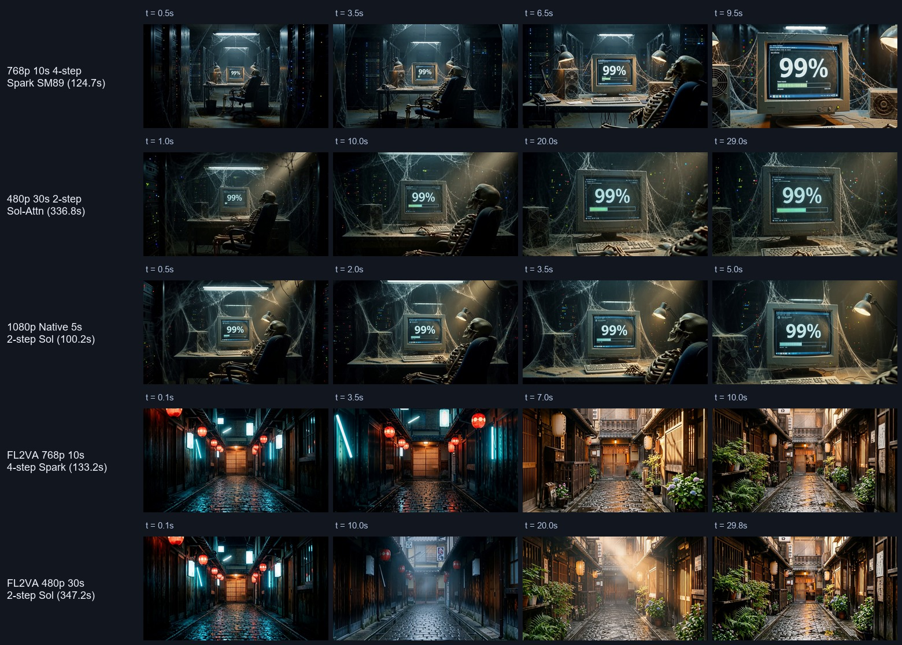

# MiniMax-H3 実験記録：`pixelaigc/ComfyUI-MiniMax-H3-pi-H3-Workflow` 続編検証（RTX 4090）

- ID: `2026-11-23-pi-h3-pixelaigc-workflow-4090`
- 実施日: `2026-11-23`
- カテゴリ: `02-low-step-generation`
- ステータス: `verified`
- GPU: `NVIDIA GeForce RTX 4090 (24564 MiB VRAM, SM 8.9)`
- 基準実験: [pi-h3-dwd-spark-4090](../pi-h3-dwd-spark-4090/README.ja.md)

記録: [English README](./README.md) · [experiment.json](./experiment.json) · [代表タイル](./previews/contact-sheet.jpg) · [manifest](./previews/contact-sheet.json) · [長尺Sol/Spark比較](./previews/compare_sol_vs_spark_long.jpg) · [FL2VA 5秒](./previews/compare_fl2va_transition.jpg) · [1080pネイティブ](./previews/compare_1080p_native_sol.jpg) · [FL2VA 10秒/30秒](./previews/compare_fl2va_long_10s_30s.jpg)

## 結論サマリー

[`pixelaigc/ComfyUI-MiniMax-H3-pi-H3-Workflow`](https://github.com/pixelaigc/ComfyUI-MiniMax-H3-pi-H3-Workflow)（`workflows/pi-H3-DWD-3060-2.json`）を既存の RTX 4090 `pi-H3` Docker 環境（`ComfyUI v0.46.0` + `ComfyUI-piFlow` + `ComfyUI-SolAttn_triton` + `Spark-H3 v0.2.0 SM89`）で検証しました。**不足ノード 0 件・追加モデル 0 件**で動作し、全 18 ラン中 17 ランが完走（黒画 0 件・AAC 32kHz ステレオ音声 RMS `-13.78 〜 -15.76 dB` 確認済み）しています。

1. **1080p ネイティブ直生成を Sol-Attn で突破**: 前回 Spark-Attn SM89 で `drop_k` エラーとなった `1920×1088 → 1920×1080`（5.17 秒・2 ステップ）が、Sol-Attn なら **100.23 秒**（Peak VRAM `22.5 GB`）で一発成功しました。
2. **30 秒（719 フレーム）生成の境界を確定**: `480p`・2 ステップは T2V（Sol **336.81 秒** / Spark **346.03 秒**）および FL2VA（Sol **347.17 秒**）がいずれも Peak VRAM `22.1〜22.7 GB` で完走。一方 `768p × 30 秒` はサンプリング時に `torch.OutOfMemoryError`（24GB 超過）となり、24GB VRAM での 30 秒実用上限が `480p` であることを確認しました。
3. **Sol-Attn vs Spark-Attn SM89**: 768p 5 秒 2 ステップ（Warm）は Sol-Attn (`31.60 秒`) が Spark-Attn (`32.32 秒`) と互角。一方、4 ステップ生成では **Spark-Attn SM89 が 25〜36% 高速**（768p 10 秒 4 ステップ `124.70 秒` vs `196.04 秒`、FL2VA 5 秒 4 ステップ `54.65 秒` vs `72.52 秒`、FL2VA 10 秒 4 ステップ `133.22 秒`）でした。
4. **長尺 FL2VA（5 秒 / 10 秒 / 30 秒）**: 「雨の夜の路地（閉じた格子戸）」→「朝日の差し込む路地（開いた引き戸と湯気）」の遷移を、10 秒（青い薄明を経由）および 30 秒（朝霧が立ち込めてから夜明け）まで破綻なく生成できました。

## 実測結果一覧

### Part A：長尺生成 ＆ Sol-Attn vs Spark-Attn SM89 比較（T2V）

| 実行ID | 解像度 | 長さ (frames) | ステップ | Attention | ComfyUI実行時間 | Peak VRAM | 平均 / 最大電力 | Cache |
|---|---|---|---:|---|---:|---:|---:|---:|
| `768p_5s_2step_sol_warmup` | 1344×768 | 5.17s (124f) | 2 | Sol-Attn | 111.40 s | 23,780 MiB | 82.5 / 410.3 W | 0 |
| **`768p_5s_2step_sol_warm`** | **1344×768** | **5.17s (124f)** | **2** | **Sol-Attn** | **31.60 s** | **23,901 MiB** | **220.0 / 382.7 W** | **11** |
| `768p_8s_2step_sol` | 1344×768 | 8.00s (192f) | 2 | Sol-Attn | 83.41 s | 23,877 MiB | 174.6 / 398.0 W | 10 |
| **`768p_8s_2step_spark`** | **1344×768** | **8.00s (192f)** | **2** | **Spark SM89** | **61.19 s** | **24,021 MiB** | **192.4 / 368.2 W** | **8** |
| **`768p_10s_2step_sol`** | **1344×768** | **10.13s (243f)** | **2** | **Sol-Attn** | **97.27 s** | **23,554 MiB** | **195.8 / 406.3 W** | **7** |
| `768p_10s_2step_spark` | 1344×768 | 10.13s (243f) | 2 | Spark SM89 | 110.48 s | 23,634 MiB | 150.4 / 368.5 W | 8 |
| `768p_10s_4step_sol` | 1344×768 | 10.13s (243f) | 4 | Sol-Attn | 196.04 s | 23,540 MiB | 171.3 / 405.0 W | 7 |
| **`768p_10s_4step_spark`** | **1344×768** | **10.13s (243f)** | **4** | **Spark SM89** | **124.70 s** | **24,004 MiB** | **242.0 / 403.3 W** | **8** |
| **`480p_30s_2step_sol`** | **864×480** | **29.96s (719f)** | **2** | **Sol-Attn** | **336.81 s** | **22,501 MiB** | **74.6 / 424.4 W** | **6** |
| `480p_30s_2step_spark` | 864×480 | 29.96s (719f) | 2 | Spark SM89 | 346.03 s | 22,693 MiB | 63.1 / 410.6 W | 8 |

### Part B ＆ C：FL2VA（5 秒 / 10 秒 / 30 秒）＆ 1080p ネイティブ・30 秒境界検証

| 実行ID | 解像度 | 長さ (frames) | ステップ | Attention | 結果 | ComfyUI実行時間 | Peak VRAM |
|---|---|---|---:|---|---|---:|---:|
| `fl2va_768p_5s_2step_sol` | 1344×768 | 5.17s (124f) | 2 | Sol-Attn | 成功 | 143.16 s (cold) | 22,493 MiB |
| `fl2va_768p_5s_4step_sol` | 1344×768 | 5.17s (124f) | 4 | Sol-Attn | 成功 | 72.52 s | 22,501 MiB |
| **`fl2va_768p_5s_4step_spark`** | **1344×768** | **5.17s (124f)** | **4** | **Spark SM89** | **成功** | **54.65 s** | **22,293 MiB** |
| **`1080p_native_5s_2step_sol`** | **1920×1088→1080** | **5.17s (124f)** | **2** | **Sol-Attn** | **成功** | **100.23 s** | **22,518 MiB** |
| `768p_to_1080p_30s_2step_sol` | 1344×768 | 29.96s (719f) | 2 | Sol-Attn | OOM (`45.1s`) | — | 24,020 MiB |
| `fl2va_768p_10s_2step_sol` | 1344×768 | 10.13s (243f) | 2 | Sol-Attn | 成功 | 106.33 s | 22,246 MiB |
| **`fl2va_768p_10s_4step_spark`** | **1344×768** | **10.13s (243f)** | **4** | **Spark SM89** | **成功** | **133.22 s** | **22,430 MiB** |
| **`fl2va_480p_30s_2step_sol`** | **864×480** | **29.96s (719f)** | **2** | **Sol-Attn** | **成功** | **347.17 s** | **22,079 MiB** |

※生成された MP4 はローカル専用（`runtime/pih3-4090/output/video/pi-h3-sequel/` および `runtime/pih3-4090/output/video/pi-h3-sequel-partc/`）で Git 対象外です。各ファイルの SHA-256 とメディア検証結果は [experiment.json](./experiment.json) に記録しています。

## X動画・参照URL

- X投稿: 未投稿（`publication.status: not_posted`）
- 対象ワークフロー: https://github.com/pixelaigc/ComfyUI-MiniMax-H3-pi-H3-Workflow
- pi-H3 アダプター: https://huggingface.co/Lakonik/pi-H3
- ComfyUI-piFlow: https://github.com/Lakonik/ComfyUI-piFlow
- ComfyUI-SolAttn_triton: https://github.com/kijai/ComfyUI-SolAttn_triton
