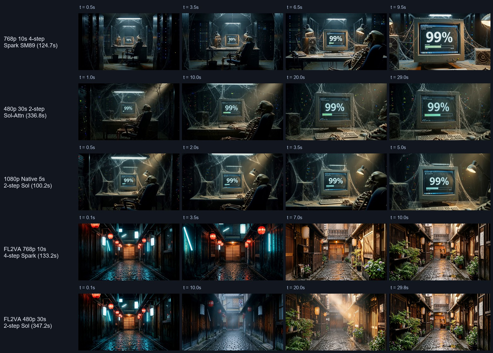

# MiniMax-H3 Experiment: pixelaigc pi-H3 Workflow on RTX 4090 (Long Duration, Sol vs Spark, Native 1080p, FL2VA)

- ID: `2026-11-23-pi-h3-pixelaigc-workflow-4090`
- Date: `2026-11-23`
- Category: `02-low-step-generation`
- Status: `verified`
- GPU: `NVIDIA GeForce RTX 4090 (24564 MiB VRAM, SM 8.9)`
- Baseline: [pi-h3-dwd-spark-4090](../pi-h3-dwd-spark-4090/README.md)

Record: [experiment.json](./experiment.json) · [tracked tile](./previews/contact-sheet.jpg) · [manifest](./previews/contact-sheet.json) · [long comparison](./previews/compare_sol_vs_spark_long.jpg) · [FL2VA 5s](./previews/compare_fl2va_transition.jpg) · [1080p native](./previews/compare_1080p_native_sol.jpg) · [FL2VA 10s/30s](./previews/compare_fl2va_long_10s_30s.jpg)

## Summary

This sequel experiment evaluates [`pixelaigc/ComfyUI-MiniMax-H3-pi-H3-Workflow`](https://github.com/pixelaigc/ComfyUI-MiniMax-H3-pi-H3-Workflow) (`workflows/pi-H3-DWD-3060-2.json`) on the existing RTX 4090 `pi-H3` Docker stack (`ComfyUI v0.46.0` + `ComfyUI-piFlow` + `ComfyUI-SolAttn_triton` + `Spark-H3 v0.2.0 SM89`) with **zero missing nodes and zero additional weights**.

- **17 of 18 runs succeeded** with zero Spark-H3 dense fallbacks, zero black frames (`blackdetect=0`), and valid synchronized stereo audio (`AAC 32 kHz stereo`, RMS `-13.78` to `-15.76 dB`).
- **Native 1080p unlocked via Sol-Attn**: `1920×1088 → 1920×1080` (5.17s, 2-step) completed in **100.23 s** (`22.5 GB` Peak VRAM), overcoming the `drop_k` error previously hit with Spark-Attn SM89.
- **30-second (719-frame) generation**: `480p` 2-step succeeded for both T2V (**336.81 s** Sol / **346.03 s** Spark) and FL2VA (**347.17 s** Sol) at `22.1–22.7 GB` Peak VRAM. `768p × 30s` hit `torch.OutOfMemoryError` (`23.99 GiB` limit), confirming `480p` as the 30-second ceiling on 24 GB VRAM.
- **Sol-Attn vs Spark-Attn SM89**: On 5s 768p 2-step (warm), Sol-Attn (`31.60 s`) matched Spark-Attn (`32.32 s`). On 4-step runs, **Spark-Attn SM89 was 25–36% faster** (`124.70 s` vs `196.04 s` at 768p 10s; `54.65 s` vs `72.52 s` on 5s FL2VA; `133.22 s` on 10s FL2VA).

## Part A: Long Duration & Sol-Attn vs Spark-Attn SM89 (T2V)

| Run ID | Resolution | Duration (Frames) | Steps | Attention | ComfyUI Time | Peak VRAM | Avg / Peak Power | Cached |
|---|---|---|---:|---|---:|---:|---:|---:|
| `768p_5s_2step_sol_warmup` | 1344×768 | 5.17s (124f) | 2 | Sol-Attn | 111.40 s | 23,780 MiB | 82.5 / 410.3 W | 0 |
| **`768p_5s_2step_sol_warm`** | **1344×768** | **5.17s (124f)** | **2** | **Sol-Attn** | **31.60 s** | **23,901 MiB** | **220.0 / 382.7 W** | **11** |
| `768p_8s_2step_sol` | 1344×768 | 8.00s (192f) | 2 | Sol-Attn | 83.41 s | 23,877 MiB | 174.6 / 398.0 W | 10 |
| **`768p_8s_2step_spark`** | **1344×768** | **8.00s (192f)** | **2** | **Spark SM89** | **61.19 s** | **24,021 MiB** | **192.4 / 368.2 W** | **8** |
| **`768p_10s_2step_sol`** | **1344×768** | **10.13s (243f)** | **2** | **Sol-Attn** | **97.27 s** | **23,554 MiB** | **195.8 / 406.3 W** | **7** |
| `768p_10s_2step_spark` | 1344×768 | 10.13s (243f) | 2 | Spark SM89 | 110.48 s | 23,634 MiB | 150.4 / 368.5 W | 8 |
| `768p_10s_4step_sol` | 1344×768 | 10.13s (243f) | 4 | Sol-Attn | 196.04 s | 23,540 MiB | 171.3 / 405.0 W | 7 |
| **`768p_10s_4step_spark`** | **1344×768** | **10.13s (243f)** | **4** | **Spark SM89** | **124.70 s** | **24,004 MiB** | **242.0 / 403.3 W** | **8** |
| **`480p_30s_2step_sol`** | **864×480** | **29.96s (719f)** | **2** | **Sol-Attn** | **336.81 s** | **22,501 MiB** | **74.6 / 424.4 W** | **6** |
| `480p_30s_2step_spark` | 864×480 | 29.96s (719f) | 2 | Spark SM89 | 346.03 s | 22,693 MiB | 63.1 / 410.6 W | 8 |

## Part B & C: FL2VA (5s / 10s / 30s) & Native 1080p / 30s VRAM Boundary

| Run ID | Resolution | Duration (Frames) | Steps | Attention | Status | ComfyUI Time | Peak VRAM |
|---|---|---|---:|---|---|---:|---:|
| `fl2va_768p_5s_2step_sol` | 1344×768 | 5.17s (124f) | 2 | Sol-Attn | success | 143.16 s (cold) | 22,493 MiB |
| `fl2va_768p_5s_4step_sol` | 1344×768 | 5.17s (124f) | 4 | Sol-Attn | success | 72.52 s | 22,501 MiB |
| **`fl2va_768p_5s_4step_spark`** | **1344×768** | **5.17s (124f)** | **4** | **Spark SM89** | **success** | **54.65 s** | **22,293 MiB** |
| **`1080p_native_5s_2step_sol`** | **1920×1088→1080** | **5.17s (124f)** | **2** | **Sol-Attn** | **success** | **100.23 s** | **22,518 MiB** |
| `768p_to_1080p_30s_2step_sol` | 1344×768 | 29.96s (719f) | 2 | Sol-Attn | error (`OOM`) | 45.07 s | 24,020 MiB |
| `fl2va_768p_10s_2step_sol` | 1344×768 | 10.13s (243f) | 2 | Sol-Attn | success | 106.33 s | 22,246 MiB |
| **`fl2va_768p_10s_4step_spark`** | **1344×768** | **10.13s (243f)** | **4** | **Spark SM89** | **success** | **133.22 s** | **22,430 MiB** |
| **`fl2va_480p_30s_2step_sol`** | **864×480** | **29.96s (719f)** | **2** | **Sol-Attn** | **success** | **347.17 s** | **22,079 MiB** |

Generated MP4s are local-only artifacts stored under `runtime/pih3-4090/output/video/pi-h3-sequel/` and `runtime/pih3-4090/output/video/pi-h3-sequel-partc/`.

## X video / reference URLs

- X video post: Not posted (`publication.status: not_posted`)
- Workflow repository: https://github.com/pixelaigc/ComfyUI-MiniMax-H3-pi-H3-Workflow
- pi-H3 adapters: https://huggingface.co/Lakonik/pi-H3
- ComfyUI-piFlow: https://github.com/Lakonik/ComfyUI-piFlow
- ComfyUI-SolAttn_triton: https://github.com/kijai/ComfyUI-SolAttn_triton
